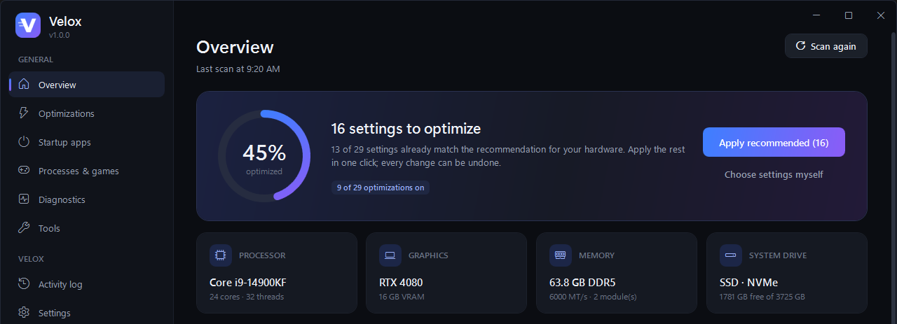

<p align="center">
  
</p>

<h1 align="center">Velox</h1>

<p align="center">
  <b>Optimizador de Windows rápido, seguro y reversible para jugar y para el día a día.</b><br>
  Cada cambio se guarda y se puede deshacer con un clic.
</p>

<p align="center"><a href="README.md">Read in English</a></p>



## Qué hace

- **Escanea tu equipo** (CPU, gráfica, RAM, pantallas, discos, plan de energía, seguridad de Windows) y **recomienda** la configuración adecuada para *tu* hardware: portátil o sobremesa, SSD o disco duro, gráfica moderna o antigua...
- **31 optimizaciones en 6 secciones desplegables**: energía y procesador, juegos y FPS, ratón y teclado, red, segundo plano y RAM, e interfaz de Windows.
- **Modo Recomendado o Personalizado**: aplica la configuración recomendada con un clic o elige cada interruptor. Al volver a *Recomendado* siempre recuperas la configuración recomendada. Los ajustes que en tu equipo son cuestión de gusto (o tienen un efecto mínimo) se marcan *A tu gusto* y el modo Recomendado no los toca.
- **Cada interruptor muestra el estado real de Windows** y no cambia nada hasta que pulsas *Aplicar cambios*.
- **Seguro**: guarda una copia de cada valor antes de cambiarlo, crea un punto de restauración antes del primer cambio y deshace una optimización si solo se aplica a medias.
- **Monitor en vivo** de CPU, RAM, GPU y VRAM (funciona aunque los contadores de rendimiento de Windows estén desactivados).
- **Drivers solo de fuentes oficiales**: Windows Update (drivers certificados por Microsoft y emparejados con cada dispositivo por su identificador de hardware) y el servidor de NVIDIA para gráficas GeForce (modelo exacto y firma de NVIDIA verificada antes de ejecutar). Nunca BIOS ni firmware, nunca versiones anteriores, punto de restauración antes, caché de shaders limpiada tras actualizar la gráfica (una caché dañada puede cerrar juegos) y botón para volver al driver anterior en cada dispositivo (también con punto de restauración antes). No toca drivers si Windows tiene un reinicio pendiente ni en un portátil con batería, y las descargas tienen tiempo límite y se pueden cancelar. Con gráficas AMD e Intel se abre su herramienta oficial.
- **Inicio de Windows**: activa o desactiva programas de inicio (igual que el Administrador de tareas).
- **Procesos y juegos**: cierra programas, sube la prioridad u optimiza un juego para siempre (prioridad alta y GPU de alto rendimiento cada vez que se abre).
- **Instalar aplicaciones** (estilo Ninite): marca aplicaciones de un catálogo de 99 programas populares en 13 categorías (asistentes de IA como Claude, ChatGPT o Gemini; complementos de IA como Obsidian, Claude Code, Ollama o ComfyUI; mensajería con WhatsApp e Instagram de la Microsoft Store; juegos como el Riot Client (confirmas tu región y dentro eliges League of Legends, VALORANT...)...) y Velox las instala una tras otra, en silencio, sin barras de herramientas ni ofertas; las que ya tienes se actualizan. Los instaladores vienen de la web oficial de cada programa a través del gestor de paquetes de Windows (winget), que comprueba el SHA-256 de cada instalador antes de ejecutarlo. Puedes añadir a «Mis aplicaciones» cualquiera de las más de 10 000 del repositorio oficial.
- **Desinstalar aplicaciones**: una versión más sencilla de la lista de Windows: busca, marca y desinstala varios programas de una vez, también las apps de Microsoft Store. Los que lo permiten (MSI, Inno Setup, desinstalación silenciosa) se quitan sin ventanas; los demás abren su propio desinstalador. Las partes de Windows, los componentes que necesitan otros programas (Visual C++, .NET, DirectX, WebView2...) y los drivers están protegidos y no se pueden desinstalar; las carpetas que quedan se pueden enviar a la papelera.
- **Diagnósticos de Windows**: SFC, DISM, comprobación de disco, salud de discos, prueba de memoria, DirectX, informes de batería y energía, monitor de confiabilidad, ping y jitter, información de red, vaciar DNS y restablecer la red.
- **Memoria RAM**: libera RAM sin cerrar ningún programa (memoria de los programas, caché de archivos, listas en espera y modificada, combinar páginas), recorta un programa concreto, limpieza automática opcional mientras Velox está abierto y desglose en vivo de memoria en uso, modificada, en espera y libre.
- **Espacio en disco**: mapa visual de lo que ocupa una unidad o carpeta (bloques proporcionales al tamaño y con colores por tipo de archivo, carpetas anidadas), lo que más ocupa, espacio por tipo, clic para entrar y clic derecho para abrir, mostrar en el Explorador, copiar la ruta o enviar a la papelera (las carpetas clave nunca se pueden borrar: Windows, Archivos de programa, ProgramData, tu perfil y AppData, Documentos, Descargas, Escritorio... ni ninguna carpeta que las contenga, ni la de un programa instalado).
- **Personalizar Windows**: 16 opciones útiles que Windows esconde, con interruptores instantáneos y reversibles, como *Finalizar tarea* en el clic derecho de la barra de tareas, el menú contextual clásico, ver extensiones y archivos ocultos, modo oscuro o quitar la espera de los programas de inicio.
- **Herramientas**: medidor de Hz del ratón, liberar RAM, limpiar temporales, punto de restauración, reiniciar el Explorador y deshacer todo.
- **Actualizador integrado** (Ajustes): comprueba la última release de GitHub, descarga `Velox.exe`, verifica su SHA-256 y que sea de verdad un Velox más nuevo, se reemplaza y se reinicia.
- **Español e inglés**, se cambia al instante.
- Un solo `.exe` pequeño que funciona en cualquier Windows 10/11 sin instalar nada.

## Lo que Velox *no* hace

- No toca la seguridad de Windows: Defender, integridad de memoria, UAC y firewall se quedan como están (si la integridad de memoria te cuesta FPS, Velox te dice dónde cambiarla).
- No desactiva Windows Update ni desinstala aplicaciones del sistema.
- No cambia la frecuencia de sondeo del ratón: la fija el propio ratón. El medidor te dice cuánta tienes.
- Sin «trucos» placebo (`LargeSystemCache`, tamaño de cola del ratón, etc.), y nada se recomienda si no ayuda de verdad en tu hardware. Los ajustes de poco impacto lo dicen en su descripción, y algunos se marcan expresamente como *no recomendados* (por ejemplo desactivar Power Throttling, que puede empeorar en procesadores con núcleos de eficiencia).

## Descargar y usar

1. Descarga `Velox.exe` de la [última versión](https://github.com/iTsJotaxx/velox/releases/latest).
2. Ábrelo y acepta el aviso de administrador (Velox cambia ajustes del sistema, así que siempre se ejecuta elevado).
3. La primera vez SmartScreen puede avisar de una app sin firmar: elige *Más información → Ejecutar de todas formas*.

Requisitos: Windows 10 u 11 de 64 bits. .NET Framework 4.8 ya viene con Windows.

## Actualizar

Abre *Ajustes → Actualizar Velox*. Velox solo descarga de las releases oficiales de este repositorio, comprueba la suma SHA-256 publicada junto al archivo, que el archivo sea Velox y más nuevo que el instalado, y entonces se reemplaza y se reinicia. Las versiones anteriores a la 1.2.0 no tienen actualizador: descarga la 1.2.0 una vez desde la página de releases.

## Cómo se deshacen los cambios

Antes de cambiar nada, Velox guarda el valor original en `C:\ProgramData\Velox\backup.xml`: valores del registro (también los que no existían), tipo de inicio de servicios, tareas programadas, ajustes del plan de energía, frecuencia de la pantalla y más. Al apagar un interruptor se restaura exactamente lo que tenías. *Herramientas → Deshacer todo* lo restaura todo de una vez. Todo queda anotado en `C:\ProgramData\Velox\velox.log`.

## Compilar

```powershell
git clone https://github.com/iTsJotaxx/velox.git
cd velox
.\build.ps1            # compilación Release -> dist\Velox.exe
```

Necesitas el [SDK de .NET](https://dotnet.microsoft.com/download) 8 o superior. La app usa .NET Framework 4.8, así que el resultado no necesita instalar nada.

## Licencia

[MIT](LICENSE)
