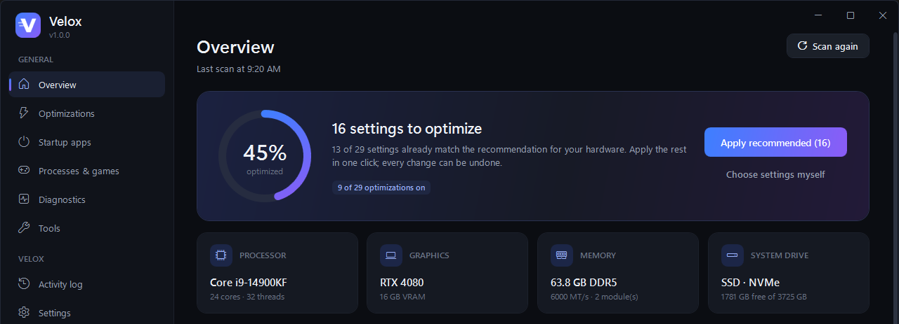
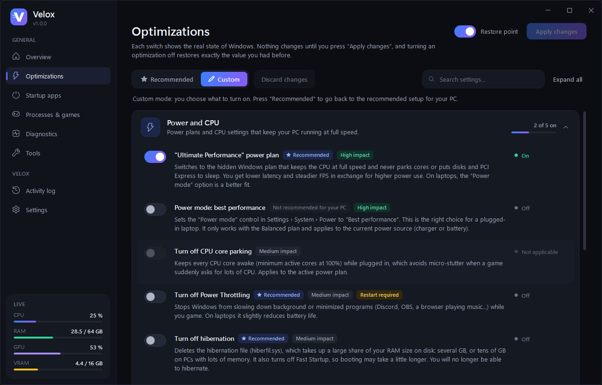
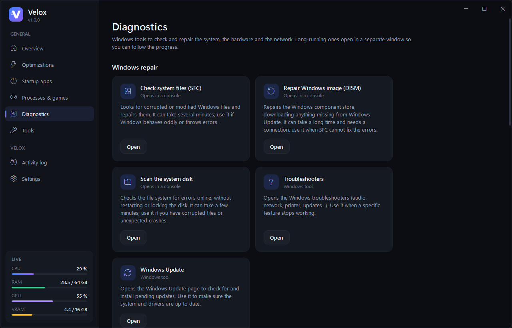
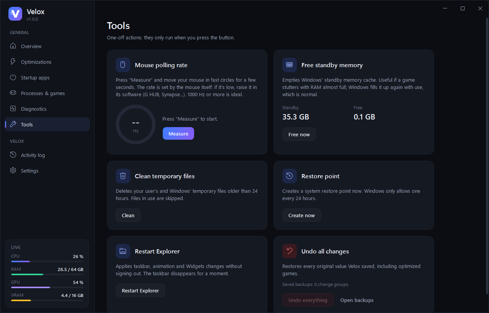

<p align="center">
  
</p>

<h1 align="center">Velox</h1>

<p align="center">
  <b>A fast, safe and reversible Windows optimizer for gaming and everyday performance.</b><br>
  Every change is backed up and can be undone with one click.
</p>

<p align="center">
  <a href="https://github.com/iTsJotaxx/velox/releases/latest"></a>
  
  
  <a href="LICENSE"></a>
</p>

<p align="center"><a href="README.es.md">Leer en español</a></p>



## Features

- **Scans your PC** (CPU, GPU, RAM, displays, disks, power plan, Windows security features) and **recommends** the right settings for *your* hardware: laptop or desktop, SSD or HDD, modern or older GPU...
- **37 optimizations in 7 collapsible sections**: games and FPS (refresh rate, fullscreen optimizations, MPO, HAGS, MMCSS...), power and CPU, background and RAM, network, mouse and keyboard, and the Windows interface. Within each section, the most noticeable settings come first and the risky ones last.
- **Risky settings are labelled**: the ones that trade security or Windows features for FPS (memory integrity, Spectre/Meltdown mitigations, Windows Search) carry a red *Risk* badge, are never part of Recommended mode, and Velox explains what you give up and asks for confirmation when you turn them on.
- **Recommended or Custom mode**: apply the recommended setup in one click, or pick each switch yourself. Switching back to *Recommended* always restores the recommended setup. Settings that are a matter of taste on your PC (or have a minimal effect) are marked *Your call* and Recommended mode leaves them alone.
- **Three setup questions** (laptop, competitive games, recording with OBS) fine-tune the recommendation; you can answer again from Settings.
- **Laptop mode**: settings Windows applies only on battery (no turbo, energy saver at 30 %), even with Velox closed.
- **Every switch shows the real state of Windows** and nothing changes until you press *Apply changes*.
- **Safe by design**: Velox backs up every original value before changing it, creates a system restore point before the first change, and rolls back an optimization if it only half applies.
- **Change history**: what Velox changed, when, from which value to which and who asked for it, with per-row *Undo*.
- **Reverted settings notice**: if a Windows update or another program puts a setting back to its base value, the Overview says so and offers to apply it again. After a restart, Velox checks that what needed the restart is still applied (and, for memory integrity, that Windows really has it off).
- **Profiles, export and import**: save named setups and export a file with your settings and the catalog apps you have installed: the kit to set up another PC, or this one after a clean install, the same way. Importing applies only what differs, through the usual confirmation.
- **Windowless mode** for automation: `Velox.exe --apply-recommended`, `--import=file.velox.json` or `--profile=name` (never applies risky settings without `--include-risky`; exit codes 0/1/2/3, `--help` lists them).
- **Live monitor** for CPU, RAM, GPU and VRAM (works even when Windows performance counters are disabled).
- **Driver updates from official sources only**: Windows Update (Microsoft-certified drivers matched to each device by hardware ID) and NVIDIA's own server for GeForce cards (exact model match, NVIDIA signature verified before running). Never BIOS/firmware, never older versions, a restore point first, shader caches cleared after a GPU driver update (stale caches can crash games), and a per-device *Roll back driver* button (with a restore point first too). Drivers are never changed while Windows has a pending restart or on a laptop running on battery, and downloads have a time limit and can be cancelled. AMD and Intel graphics open their official tools.
- **Startup apps** manager (same mechanism as Task Manager).
- **Processes & games**: end apps, raise priority, or optimize a game permanently (high CPU priority + high-performance GPU every time it starts).
- **Install apps** (Ninite-style): tick apps from a catalog of 85 popular programs in 12 categories (AI assistants such as Claude, ChatGPT or Gemini; AI add-ons such as Obsidian, Claude Code, Ollama or ComfyUI; messaging including WhatsApp and Instagram from the Microsoft Store; games including League of Legends and VALORANT, which ask you to confirm the server region, preselected from the country set in Windows...) and Velox installs them one after another, silently, with no toolbars or offers; the ones you already have get updated. It also lists installed apps with a new version (anything winget knows) and updates them silently; runtimes are left unticked. Installers come from each program's official website through Windows' package manager (winget), which checks every installer's SHA-256 before running it. You can add any of the 10,000+ apps in the official repository to «My apps».
- **Uninstall apps**: a simpler take on the Windows list: search, tick and uninstall several programs in one go, including Microsoft Store apps. Programs that support it (MSI, Inno Setup, silent uninstall) are removed with no windows; the rest open their own uninstaller. Windows parts, components that other programs need (Visual C++, .NET, DirectX, WebView2...) and drivers are protected and cannot be uninstalled, and leftover install folders can be sent to the Recycle Bin.
- **Windows diagnostics**: a *health report* by area (drive, disks, memory, optimizations, restarts, startup, antivirus) with a shortcut to where each thing is fixed; SFC, DISM, disk check, disk health, memory test, DirectX, battery and energy reports, reliability monitor, ping/jitter test, network info, DNS flush and network reset.
- **Memory (RAM)**: free up RAM without closing any program (program working sets, file cache, standby and modified lists, page combining), trim a single program, optional automatic standby cleaning while Velox is open, and a live breakdown of in use / modified / standby / free memory.
- **Disk space**: a visual map of what fills a drive or folder (blocks sized by space and colored by file type, nested folders), the biggest items, space by file type, click to go inside, and right-click to open, show in File Explorer, copy the path or send to the Recycle Bin (key folders can never be deleted: Windows, Program Files, ProgramData, your profile and AppData, Documents, Downloads, Desktop... nor any folder that contains them, nor the folder of an installed program).
- **Windows tweaks**: 16 handy hidden options with instant, reversible switches, such as *End task* when right-clicking the taskbar, the classic right-click menu, file extensions, hidden files, dark mode or no startup delay.
- **Tools**: deep clean (temp files, Windows Update downloads, Delivery Optimization, caches of closed browsers and shaders, thumbnails and error reports: it measures first and deletes only what you tick), one-click DNS (measures Cloudflare, Google and Quad9 from your connection, switches and goes back to the original), restore point, free up RAM, mouse polling-rate meter, restart Explorer, undo everything.
- **Built-in updater** (Settings): checks the latest GitHub release, downloads `Velox.exe`, verifies its SHA-256 and that it really is a newer Velox, replaces itself and restarts.
- **English and Spanish**, switchable instantly.
- A single small `.exe` that runs on any Windows 10/11 with nothing to install.

| Optimizations | Diagnostics | Tools |
|---|---|---|
|  |  |  |

## What Velox will *not* do

- It never touches Defender, UAC or the firewall. Memory integrity and CPU mitigations are only turned off if you choose so, with a *Risk* badge and a warning first, and the same switch turns them back on.
- It does not disable Windows Update or uninstall built-in apps.
- It does not change your mouse polling rate: that is set by the mouse itself. The built-in meter tells you what you have.
- No placebo "tweaks" (`LargeSystemCache`, `Win32PrioritySeparation`, mouse data queue size, etc.), and nothing is recommended unless it actually helps on your hardware. Low-impact settings say so in their description, and some are explicitly *not* recommended (for example turning off Power Throttling, which can hurt CPUs with efficiency cores).

## Download and run

1. Download `Velox.exe` from the [latest release](https://github.com/iTsJotaxx/velox/releases/latest).
2. Run it and accept the administrator prompt (Velox changes system settings, so it always runs elevated).
3. Windows SmartScreen may warn about an unsigned app the first time: choose *More info → Run anyway*.

Requirements: Windows 10 or 11 (64-bit). .NET Framework 4.8 is already part of Windows.

## Updating

Open *Settings → Update Velox*. Velox only downloads from the official releases of this repository, checks the SHA-256 published next to the file, checks that the file is Velox and newer than the installed version, then swaps itself and restarts. Versions before 1.2.0 have no updater: download 1.2.0 once from the releases page.

## How undo works

Before changing anything Velox stores the original value in `C:\ProgramData\Velox\backup.xml`: registry values (including values that did not exist), service start types, scheduled tasks, power plan settings, display refresh rate and more. Turning a switch off restores exactly what you had. *Tools → Undo everything* restores every saved value at once. Everything Velox does is written to `C:\ProgramData\Velox\velox.log`.

## Build from source

```powershell
git clone https://github.com/iTsJotaxx/velox.git
cd velox
.\build.ps1            # Release build -> dist\Velox.exe
```

You need the [.NET SDK](https://dotnet.microsoft.com/download) (8 or later). The app itself targets .NET Framework 4.8, so the result needs no runtime.

### Project layout

```
src/Velox
  Core/          engine: registry, backups, services, power plans, scanner, optimizations, Windows tweaks, disk scanner, memory, tools, diagnostics
  Native/        Win32 interop (SystemParametersInfo, displays, raw mouse input, memory lists, NVML, PDH)
  UI/            WPF interface (theme, views, view models)
  Localization/  es / en string dictionaries
tests/Velox.IntegrationTests   applies and reverts every optimization and Windows tweak and checks Windows is left identical
```

The integration test really changes (and restores) system settings, so it must be run manually as administrator. See [tests/README.md](tests/README.md).

## Contributing

Issues and pull requests are welcome. New optimizations must be reversible, documented in both languages, and pass the integration test.

## License

[MIT](LICENSE)
